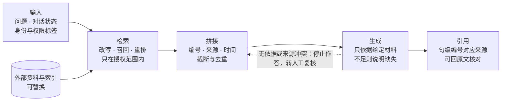

# 检索增强生成（Retrieval-Augmented Generation，RAG）

| 项目      | 填写内容                                                              |
| :------ | :---------------------------------------------------------------- |
| 词条序号    | 09                                                                |
| 姓名或课程署名 | 李灿玥                                                               |
| 学号后四位   | 5007                                                              |
| 更新时间    | 2026-11-12                                                        |
| 稿件状态    | 初稿                                                                |
| 个人贡献    | 资料查阅与逐条核验、案例设计、检索脚本编写与运行、正文撰写与修订                                  |
| AI协助    | 2026-11-12 使用 AI 辅助梳理结构、润色表述、起草检索脚本；文献条目均由本人打开原始页面逐项核对，无法核实的表述已删除 |

## 一、定义与概念边界

检索增强生成（Retrieval-Augmented Generation，RAG）指生成回答前先从外部资料中检索相关片段，再把片段放进上下文，让模型据此作答并标注出处的一类系统做法。刘易斯等人在 2020 年提出这一名称时，强调的是把预训练模型参数中的“参数化记忆”与外部文档索引这一“非参数化记忆”结合起来，用于知识密集型任务[1]。

有三点边界需要说明。第一，RAG 是一套系统流程，不是某个模型的名字；同一个模型配不同的检索器、分块方式和提示，效果可能相差很大[2]。第二，外部资料不限于向量库：原始论文用的是维基百科的稠密向量索引[1]，实际项目也可以是机构制度或稿件库。第三，RAG 的目标是让回答有可回查的依据，而非保证正确；检索没找到、找到不相关、模型不按材料说话，都会让目标落空。

## 二、背景与工作原理

大模型把知识压缩进参数，带来三个问题：知识停留在训练截止时间；难以说明判断依据；更新只能重训，代价很高[1][2]。微调能缓解一部分，但知识一变就要再训。RAG 把“记住”和“查阅”分开：知识放进可替换的外部索引，模型只负责读懂和表达，更新时替换文档即可[1]。

完整流程可以拆成五步，如图 1。

图1：检索增强生成的五个环节。来源：作者自绘，2026-11-12；矢量源文件见 `figure/09/rag-flow.svg`。

**输入。** 系统接收问题，通常还带对话状态、身份与权限标签；权限标签决定能检索哪些资料，必须在检索前生效，而不是靠提示词约束。

**检索。** 先把问题改写成适合检索的形式（补全指代、拆成子问题），再在授权范围内召回候选片段。召回可用 BM25 这类词频统计方法，也可用双编码器把问题与段落编码成向量按相似度取回[3]；实践中常混用，再用更强的模型重排前几十条。跨领域测试显示，BM25 是稳健基线，重排序与后期交互平均更好但开销更大，稠密检索在分布外数据上并不总是更优[4]。

**拼接。** 把候选片段按编号、标题、时间、来源链接整理进上下文，并写明“只依据以下材料回答”。这一步有三个易错点：片段总长受窗口限制，需截断与去重；关键片段落在长上下文中间容易被忽略，放开头或结尾更可靠[5]；片段互相矛盾时模型易只挑一条，需要求并列呈现。

**生成。** 模型依据片段组织答案，材料未覆盖时应说明“资料不足”。例如问“该规定何时生效”，材料只写了公布日期，答句就该写“材料未给出生效日期”，而不是补一个日期。

**引用。** 输出中每条事实性陈述对应一个片段编号，文末给出可点击来源。引用不是装饰：要能顺着编号回到原文，确认该片段确实支持这句话。

## 三、应用案例

面向研究生课程“文献综述”任务做主题速读与综述初稿；案例状态：待验证设计。

| 要素     | 内容                                                                                     |
| :----- | :------------------------------------------------------------------------------------- |
| 使用者与问题 | 课程小组 3 人，两周内读完 20 篇公开论文并回答 15 个主题问题；困难是读得慢、记不准结论、引文与页码常错配                              |
| 材料与权限  | 仅使用 arXiv 上公开下载的论文 PDF，页面标注为 CC BY 4.0、CC BY-SA 4.0 或 arXiv 非独占许可；不使用未发表稿件、审稿意见与访谈原始记录 |
| 输入与输出  | 输入为 15 条问题与论文 PDF；输出为每条问题 2—4 句答案，附[论文编号＋章节号]，无法回答的写明“材料未覆盖”                          |
| 模型与工具  | 检索侧为本文自写脚本（BM25，见第四节）；生成侧设计为通用对话模型加文档问答界面。本次未接入模型服务，故不记录版本                             |
| 流程与分工  | 人工定问题清单与标准答案→脚本检索前 5 条片段→人工核对是否切题→模型据片段作答→双人逐条核对引用→汇总修订                            |
| 核验标准   | ①引文可在 PDF 中定位且页码正确；②答案不含片段外的事实；③“材料未覆盖”判断正确；④两人独立核对，分歧由第三人裁定                           |
| 失败与接管  | 前 5 条片段均不相关、片段之间结论冲突、问题涉及论文未报告的数据、资料中出现“忽略以上指令”类文字时，停止自动作答，转人工处理                       |

## 四、最小验证与结果

### 1. 操作与输入

运行日期 2026-11-12，只验证检索环节。语料为 12 段中文短文：P01—P10 依据本文参考资料改写，P11、P12 为人工设置的干扰段；查询 10 条，分常规、干扰、改写三类。两种方案共用同一分词器（中文按相邻两字切分，英文与数字按词切分），只改变打分方式：方案 A 为关键词覆盖率（命中的不同词项数÷查询词项数，无逆文档频率、无长度归一化），方案 B 为 BM25（k1=1.5，b=0.75）。脚本与语料见 [retrieval\_check.js](2026-11-12/09-rag/work/retrieval_check.js)，可在任意 JavaScript 环境重跑。标准答案是作者按段落主题事先指定的。

### 2. 原始输出与核验

| 测试编号   | 方案    | 原始输出（目标段排名与前三名得分）                                  | 预设标准与核验依据 | 结果                |
| :----- | :---- | :------------------------------------------------- | :-------- | :---------------- |
| Q01 常规 | A / B | A:1（P01/0.600, P08/0.150）／B:1（P01/23.00, P08/3.27） | 目标段列第 1   | 均通过               |
| Q02 干扰 | A / B | A:1（P02/0.688, P11/0.313）／B:1（P02/18.94, P11/8.34） | 干扰段不得排第 1 | 均通过               |
| Q04 干扰 | A / B | A:1（P12/0.500, P08/0.188）／B:1（P12/14.59, P08/5.52） | 干扰段不得排第 1 | 均通过               |
| Q06 常规 | A / B | A:1（P07/0.375, P02/0.125）／B:1（P07/9.77, P04/2.11）  | 目标段列前 3   | 均通过               |
| Q09 改写 | A / B | A:1（P07/0.071, P10/0.071）／B:2（P10/1.70, P07/1.57）  | 目标段列前 3   | A 为并列分侥幸命中，B 排第 2 |
| Q10 改写 | A / B | A:9（P02/0.077, P04/0.077）／B:9（P04/1.81, P02/1.38）  | 目标段列前 3   | 均未命中              |

程序输出的汇总为：`A: P@1=0.900  P@3=0.900  MRR=0.911`；`B: P@1=0.800  P@3=0.900  MRR=0.861`。按类型（A 命中@1／B 命中@1）：常规 6/6，干扰 2/2，改写 1/0。

### 3. 结果解释

常规与干扰组两种方案都命中，差别只在分差：Q01 的 BM25 头名 23.00、次名 3.27，覆盖率方案为 0.600 与 0.150。改写组暴露共同缺陷：查询“把长文档切成多大的片段才合适”与目标段几乎没有共同词项，两种词法方案都排到第 9 位。Q09 的“命中”只是 0.071 并列时按编号排出的偶然，不算有效命中。

本次实验能支持的结论有限：词法检索够不够用取决于用户怎么问，一旦提问用词与材料错开，就必须引入向量检索或先做查询改写。样本只有 10 条查询，不能推断两种方案的普遍优劣；生成与引用环节未运行，属待验证设计。

## 五、相近概念与常见误区

**与微调比较。** 微调改的是模型参数，适合调整风格与任务能力，知识更新要重训；RAG 改的是外部索引，适合频繁变化、需要出处的知识。两者可以叠加：先微调让模型学会“按编号引用”，再用 RAG 提供当日资料。

**与长上下文比较。** 长上下文是把材料整篇塞进窗口，省去检索，但成本随长度上升，关键信息位于中部时还会被忽略[5]。RAG 先筛选，把窗口留给最相关片段，代价是多了一个可能出错的检索环节。

**与语义检索比较。** 语义检索只是 RAG 的一个部件，负责“找得到”；RAG 还要“拼得对、答得准、引得回”。把向量库接上模型就宣称做了 RAG，往往缺的正是后三步。

**常见误解：RAG 能消除幻觉。** 不能。检索为空时模型仍可能凭参数作答；片段相关但不含答案时，模型可能把相邻内容拼成看似合理的结论；有编号也不代表该片段支持这句话。

## 六、局限与负责任使用

检索质量决定上限：分块过粗会混入无关内容，过细会切断上下文；索引过期会答出旧规定。资料权限必须在检索前过滤，只索引已获授权的材料，不能把“不要回答涉密内容”写进提示词当作权限控制。个人信息遵循最小必要，索引中去除姓名、联系方式等字段，原始材料定期清理。

提示注入是 RAG 特有的风险：攻击者可以把指令藏进将被检索的网页或文档，让系统泄露数据或误调工具[6]。应对办法是把检索到的文本一律当作数据而非指令、限制工具权限、对来源做白名单与人工抽查。

人工接管应设在四处：检索无相关结果、来源结论冲突、对外发布或法律财务判断、问题超出材料范围。上线后按比例抽查引用是否成立，不合格即回退到人工撰写[7]。

## 七、总结

RAG 把“记住知识”与“查阅资料”分开，用可替换的外部索引弥补参数知识的时效与出处缺陷。它的效果由检索、拼接、生成、引用四个环节共同决定，任何一环失守都会让“有依据”变成形式。词法检索在术语重合时可靠，遇到改写提问则需要向量检索或查询改写配合。引用必须能回到原文核验，这既是质量指标，也是责任边界。本次只实测了检索环节，生成与引用环节仍需在真实材料上验证。

## 八、参考资料

著录格式：中文文献按 GB/T 7714—2015 著录，英文文献按 APA 第 7 版著录。本文参考资料均为英文文献，故统一用 APA 格式；编号沿用正文的顺序编码制标记，以便与 [n] 一一对应。

[1] Lewis, P., Perez, E., Piktus, A., Petroni, F., Karpukhin, V., Goyal, N., Küttler, H., Lewis, M., Yih, W., Rocktäschel, T., Riedel, S., & Kiela, D. (2020). Retrieval-augmented generation for knowledge-intensive NLP tasks. In *NeurIPS 2020*. https://doi.org/10.48550/arXiv.2005.11401

[2] Gao, Y., Xiong, Y., Gao, X., Jia, K., Pan, J., Bi, Y., Dai, Y., Sun, J., Wang, M., & Wang, H. (2023). Retrieval-augmented generation for large language models: A survey (arXiv:2312.10997). arXiv. https://doi.org/10.48550/arXiv.2312.10997

[3] Karpukhin, V., Oğuz, B., Min, S., Lewis, P., Wu, L., Edunov, S., Chen, D., & Yih, W. (2020). Dense passage retrieval for open-domain question answering. In *EMNLP 2020*. https://doi.org/10.48550/arXiv.2004.04906

[4] Thakur, N., Reimers, N., Rücklé, A., Srivastava, A., & Gurevych, I. (2021). BEIR: A heterogenous benchmark for zero-shot evaluation of information retrieval models. In *NeurIPS 2021 Datasets and Benchmarks Track*. https://doi.org/10.48550/arXiv.2104.08663

[5] Liu, N. F., Lin, K., Hewitt, J., Paranjape, A., Bevilacqua, M., Petroni, F., & Liang, P. (2023). Lost in the middle: How language models use long contexts (arXiv:2307.03172). arXiv. https://doi.org/10.48550/arXiv.2307.03172（已被 TACL 接收）

[6] Greshake, K., Abdelnabi, S., Mishra, S., Endres, C., Holz, T., & Fritz, M. (2023). Not what you've signed up for: Compromising real-world LLM-integrated applications with indirect prompt injection (arXiv:2302.12173). arXiv. https://doi.org/10.48550/arXiv.2302.12173

[7] Es, S., James, J., Espinosa-Anke, L., & Schockaert, S. (2023). Ragas: Automated evaluation of retrieval augmented generation (arXiv:2309.15217). arXiv. https://doi.org/10.48550/arXiv.2309.15217

以上 7 条均由作者于 2026-11-12 打开链接查阅并核对作者、年份、标题与编号，逐条结论见核验记录；DOI 链接为 arXiv 官方登记号，可长期回查。

## 九、AI使用与修订记录

AI 用于三处：梳理章节结构、润色语句、起草检索脚本。所有文献条目均由本人打开 arXiv 摘要页核对作者、年份、标题、发表处与编号，核验记录见 [reference-check.md](2026-11-12/09-rag/work/reference-check.md)；脚本由本人运行并检查输出，未采用任何未经核对的数字或引文。

| 日期         | 修改内容                     | 修改依据                       |
| :--------- | :----------------------- | :------------------------- |
| 2026-11-12 | 完成初稿；补入检索环节实测            | 7 项文献逐条核验；本地脚本运行结果         |
| 2026-11-12 | 把“RAG 可消除幻觉”改写为常见误解并补充反例 | 复核[2][7]原文表述，原文只主张降低部分风险 |
| 2026-11-12 | 参考资料统一为 APA 第 7 版，正文编号按首次引用顺序调整 | 引用格式检查，见核验记录第五节 |

[返回词条目录](README.md)
